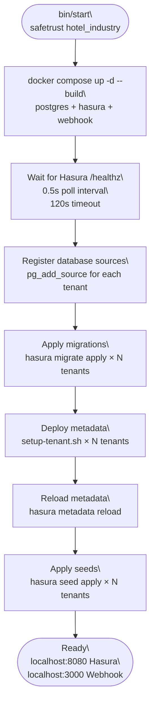

# bin/start

## Flow


## Prerequisites
- Docker
- hasura CLI
- yq

## Ports (hardened default)

| Service | Published on host | Reachable from |
| --- | --- | --- |
| Postgres (`postgres`) | **No** | Only from inside the Docker network (`postgres:5432`). The superuser port is not exposed on the host. | 
| Hasura (`graphql-engine`) | `127.0.0.1:${HASURA_PORT:-8080}` | Local machine only. A reverse proxy / deployment platform exposes it publicly. |
| Webhook (`webhook`) | `127.0.0.1:${WEBHOOK_PORT:-3000}` | Local machine only. A reverse proxy / deployment platform exposes it publicly. |

Test compose (`docker-compose-test.yml`) binds **everything** to `127.0.0.1`, including the Hasura console on `127.0.0.1:9696`.

### Local Postgres access (override, git-ignored)

If a local tool needs direct Postgres access, use a git-ignored override rather than
publishing the port in the main compose file:

`docker-compose.override.yml` (do **not** commit):

```yaml
services:
  postgres:
    ports:
      - "127.0.0.1:${POSTGRES_PORT:-5433}:5432"
```

This binds Postgres to loopback only, so the superuser port is still not reachable
from the network.

## Database roles (least privilege)

The stack no longer runs every connection as the Postgres superuser. Roles are
created by the migration step and used by the running services:

| Role | Used by | Rights |
| --- | --- | --- |
| `postgres` (admin) | `bin/start`, `bin/prepare-test-db` (migrations/metadata/seeds only) | Superuser, used only by the migration step, never by a running service. |
| `hasura` | Hasura data source (`PG_DATABASE_URL`) | `CONNECT` on the tenant database + `USAGE` on the public schema. No `CREATE`, no superuser. |
| `hasura_metadata` | Hasura catalog (`HASURA_GRAPHQL_METADATA_DATABASE_URL`) | Owns the `hasura_metadata` database. The data-source role has no rights on that database. |
| `webhook` | Webhook service (`POSTGRES_USER`) | `CONNECT` + `USAGE` on the tenant database; `SELECT/INSERT/UPDATE/DELETE` on the tables it uses. No `CREATE`, no superuser. |

Migrations and metadata are applied as the admin role. `bin/prepare-test-db`
(`docker-compose-test.yml` → `migrate-test`) creates the roles and the metadata
database, then applies migrations as the admin role.

### Why the metadata lives in its own database

Hasura's catalog (metadata, sources, actions, triggers) is stored in
`hasura_metadata`, owned by `hasura_metadata`. A breach of a tenant database role
(`hasura`) or the webhook role does not expose the catalog, and a breach of the
catalog does not give access to tenant data.

## Secrets

Production secrets are read from files when present, and fall back to environment
variables for local development. The webhook supports the `*_FILE` variants that the
official Postgres image already uses:

| Secret | Env var | File-backed variant |
| --- | --- | --- |
| Postgres password | `POSTGRES_PASSWORD` | `POSTGRES_PASSWORD_FILE` |
| Hasura admin secret | `HASURA_GRAPHQL_ADMIN_SECRET` | `HASURA_GRAPHQL_ADMIN_SECRET_FILE` |
| TrustlessWork API key | `TRUSTLESSWORK_API_KEY` | `TRUSTLESSWORK_API_KEY_FILE` |
| TrustlessWork webhook secret | `TRUSTLESSWORK_WEBHOOK_SECRET` | `TRUSTLESSWORK_WEBHOOK_SECRET_FILE` |
| Firebase private key | `FIREBASE_PRIVATE_KEY` | `FIREBASE_PRIVATE_KEY_FILE` |

When both the plain variable and the `_FILE` variant are set, the file wins. Missing
required secrets fail fast in production: `docker-compose.yml` uses
`${POSTGRES_PASSWORD:?...}` and `${HASURA_GRAPHQL_ADMIN_SECRET:?...}` so a missing
password/secret stops the stack early rather than starting with empty credentials.

File-backed secrets are mounted at `/run/secrets/...` in `docker-compose.yml` via the
`secrets:` block. The values themselves still come from the environment / CI secrets /
deployment platform (Compose `environment: ... environment: NAME` reads the host
environment variable).

Required environment variables
- `POSTGRES_PASSWORD`
- `HASURA_GRAPHQL_ADMIN_SECRET`

Optional (have sensible development defaults):
- `HASURA_GRAPHQL_JWT_SECRET`
- `TRUSTLESSWORK_API_KEY`
- `TRUSTLESSWORK_WEBHOOK_SECRET` (required in test; `TEST_WEBHOOK_SECRET` defaults)

## Logs

`HASURA_GRAPHQL_ENABLED_LOG_TYPES` defaults to `startup, http-log, webhook-log,
websocket-log` — **no `query-log`**. `query-log` writes every GraphQL query with its
variables (emails, phone numbers, wallet addresses) to the container log; enable it
per-run only when debugging.

Every service sets log rotation:

```yaml
logging:
  driver: json-file
  options:
    max-size: "10m"
    max-file: "5"
```

## Container hardening

Every service sets:
- `security_opt: ["no-new-privileges:true"]`
- `cap_drop: ["ALL"]` (Postgres re-adds only the capabilities it needs)
- `mem_limit`, `cpus`, `pids_limit`
- `logging` with rotation (above)

The webhook also runs `read_only: true` with `tmpfs` mounts for `/tmp` and its dist
directory.

## Hasura console access

The console is not published on the host by default. To open it locally:

```bash
hasura console --endpoint http://localhost:${HASURA_PORT:-8080} --admin-secret "$HASURA_GRAPHQL_ADMIN_SECRET"
```

Or use the `docker-compose.override.yml` example above and `docker compose port
graphql-engine 8080`.

## Image pinning

All base images are pinned by digest, with the tag kept as a comment so Dependabot /
the Trivy CI job can track updates:

```yaml
image: node:24-bookworm-slim@sha256:... # 24-bookworm-slim
image: hasura/graphql-engine:v2.47.0@sha256:... # v2.47.0
image: postgis/postgis:15-3.3@sha256:... # 15-3.3
image: debian:bookworm-slim@sha256:... # bookworm-slim
image: eclipse-temurin:17-jdk-jammy@sha256:... # 17-jdk-jammy
```

The Trivy job in `.github/workflows/security-scan.yml` scans the built webhook image
(fail on fixable HIGH/CRITICAL) and the Compose/Dockerfiles (`trivy config`) on every
PR that touches a Dockerfile or Compose file. Dependabot Docker entries keep the
digests current.

## Usage

- `bin/start safetrust` vs `bin/start safetrust hotel_industry`
- `bin/start --reset safetrust hotel_industry` — full teardown and fresh start
- `bin/start --restart safetrust hotel_industry` — recreate the containers while preserving volumes
- `TRACK_SAFETRUST_TIMINGS=true bin/start safetrust` — write timings to `tests/results/dc-prep-timings.json`

## bin/test

```bash
bin/test
```

Runs the Karate API suite against `docker-compose-test.yml`. The test stack binds to
`127.0.0.1`, creates the least-privilege roles, and applies migrations before the
Karate service starts.

## Common failures and fixes
- `POSTGRES_PASSWORD` / `HASURA_GRAPHQL_ADMIN_SECRET` not set — the stack fails fast with a message from `${VAR:?...}`.
- Port 5433 already in use — only matters if you added a `docker-compose.override.yml` publishing Postgres; the default does not publish it.
- Hasura health timeout — the health endpoint is on `127.0.0.1:${HASURA_PORT:-8080}`; make sure `HASURA_PORT` matches the override you are using.
- Seed duplicate key errors — idempotent seed files should use `ON CONFLICT DO NOTHING`.
- Webhook cannot connect to Postgres as `webhook` — ensure `bin/prepare-test-db` (or the equivalent init step in production) has created the `webhook` role and granted `CONNECT` + `USAGE`.
